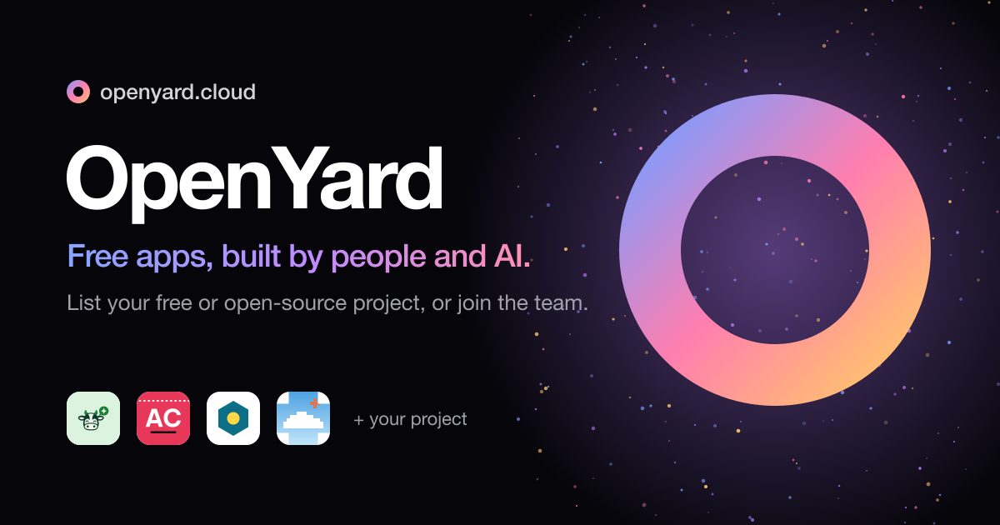

<p align="center"><a href="https://openyard.cloud"></a></p>
<h1 align="center">OpenYard</h1>

<p align="center"><a href="https://openyard.cloud"></a></p>

<p align="center">
  <a href="https://openyard.cloud"></a>
  <a href="LICENSE"></a>
</p>

**A community for people who make free software: free apps, wild ideas and open tools.**

[openyard.cloud](https://openyard.cloud) · [Discuss](https://openyard.cloud/discuss) · [Submit a project](https://openyard.cloud/submit) · [Introduce yourself](https://github.com/openyard-cloud/openyard/issues/new?template=join-team.yml) · [Discussions](https://github.com/openyard-cloud/openyard/discussions)

OpenYard is a shared yard for people who make free things. You build on your own GitHub or site, then bring your project here to show it off, get feedback, find testers and ask for help. Every project gets its own page at `openyard.cloud/p/<slug>` with its GitHub stars, pull requests, issues and discussions, and the busiest ones rise to the top of Trending.

## Put your project in the yard

Fill in the form at **[openyard.cloud/submit](https://openyard.cloud/submit)**. No account needed: paste your GitHub link to fill it in, send it, and your project is live right away. You get a private link to edit or remove it later.

There is one rule: **it has to be free to use.** Open source is welcome but not required. Any stage, any stack, any size.

Want `yourproject.openyard.cloud`? Ask in [Discuss](https://openyard.cloud/discuss/ideas).

## Every repository gets a code check

Projects with a GitHub repository are read by [vetcode](https://github.com/openyard-cloud/vetcode) and checked again whenever their code changes. Nothing is installed or run. The project page then shows:

- **What the code can do.** Whether it reads secrets, connects to the internet, starts other programs, reads user and machine details, writes to startup folders, or builds code while it runs. This is a label read from the code itself, not written by the maker.
- **Abilities that are new since the previous check.** An update that suddenly gains network access or starts reading secrets is how hijacked packages usually show up.
- **Malware and supply-chain findings**, with links to the exact lines. Vulnerability candidates and leaked-secret locations are never published, so nobody is pointed at an unfixed problem.
- **What the project asks vetcode to skip**, so nothing can be hidden quietly.

Anyone can do the same for **any public GitHub repository** at [openyard.cloud/check](https://openyard.cloud/check): paste a link and the result appears in a minute or two, at a page that stays, such as `openyard.cloud/check/expressjs/express`, with its own badge at `/badge/gh/<owner>/<repo>.svg`. The site asks the scanner workflow through a `repository_dispatch` (the `DISPATCH_TOKEN` Worker secret, a fine-grained token with Contents read and write on this repository); without it, waiting checks are picked up by the six-hourly run.

Makers can add the result to their README:

```markdown
[](https://openyard.cloud/p/<slug>#check)
```

The checks run in [`.github/workflows/vet.yml`](.github/workflows/vet.yml) with [`scripts/vet.mjs`](scripts/vet.mjs), which posts each result with the `VET_TOKEN` secret (set the same value in GitHub Actions and with `npx wrangler secret put VET_TOKEN`).

## Join the community

Share what you are making, ask when you are stuck, help someone else. Developers, designers, translators, testers and people with ideas are all welcome. Come say hi in [Discuss](https://openyard.cloud/discuss), or [introduce yourself](https://github.com/openyard-cloud/openyard/issues/new?template=join-team.yml).

## Run the site locally

```sh
npm run dev      # local database with the seed projects, on http://localhost:8787
npm run check    # syntax check
```

Discussions live on the site (`/discuss`, `src/discuss.js`): topics in Help, Ideas & feedback, Building in public and General, with replies through the comment code; new projects are the Showcase. One Cloudflare Worker serves everything: static files from `public/` (home page, submit form), and from `src/worker.js` the API, project pages, sitemap and a cron trigger that refreshes GitHub stats. Projects live in a D1 database (`migrations/`). Every push to `main` deploys through Cloudflare Workers Builds, whose deploy command is `npm run deploy`: it applies new migrations to the production database first, then deploys the Worker. An optional `GITHUB_TOKEN` secret raises GitHub's rate limit and adds discussions to project pages. People sign in with GitHub (`src/auth.js`, scopes `read:user user:email`) or, without GitHub, with a one-time link by email (`/signin`, `/auth/email`): those accounts pick a nickname and get a generated picture (`/a/<seed>/<letter>.svg`); a first sign-in goes through `/welcome` (interests, email consent), `/settings` changes those and deletes the account, and `/@<login>` is a public profile (`src/account.js`). A project submitted while signed in belongs to that account, and anyone listed as its maker can edit it without the private link. Email goes through Resend (`src/email.js`, the `RESEND_API_KEY` secret, sender in the `EMAIL_FROM` var): a welcome when someone turns email on, replies, comments on your project, code-check changes and a Monday digest, only with consent and with one-click unsubscribe. Messages wait in the `outbox` table and go out right away and hourly from the cron, under `EMAIL_DAILY_LIMIT` a day (the free plan allows 100). The submit form asks for an email (`projects.contact_email`, never shown): the maker gets their page and private edit link by email, comments and a daily note of likes, and tips on day 3 and day 7. Signed-in people can like a project; likes count toward Trending. Bạn làm dự án trên GitHub hay trang của mình, rồi mang tới đây để khoe, nhận góp ý, tìm người test và hỏi han khi bí. Luật chỉ có một: dự án phải miễn phí.

Bạn có dự án miễn phí? Điền form tại [openyard.cloud/submit](https://openyard.cloud/submit): không cần tài khoản, gửi xong là có mặt trên OpenYard ngay.

Mọi dự án có repo GitHub đều được vetcode đọc (không chạy) và kiểm tra lại mỗi khi code thay đổi. Trang dự án hiện code đó làm được gì (đọc secret, dùng mạng, chạy chương trình khác…), khả năng nào mới xuất hiện so với lần trước, và các dấu hiệu mã độc nếu có.

## License

MIT for the code in this repository. Each listed project keeps its own name, logo and license.
