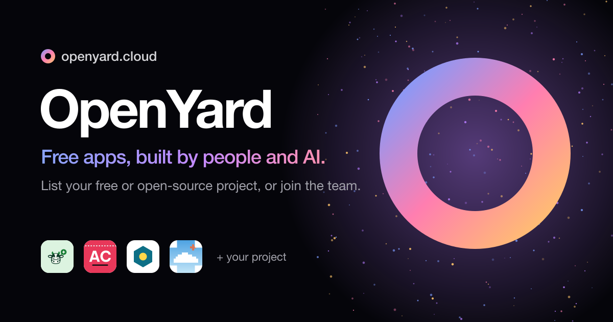

<p align="center"><a href="https://openyard.cloud"></a></p>
<h1 align="center">OpenYard</h1>

<p align="center"><a href="https://openyard.cloud"></a></p>

<p align="center">
  <a href="https://discord.gg/TFKsfh6tMk"></a>
  <a href="https://openyard.cloud"></a>
  <a href="LICENSE"></a>
</p>

**A community for people who make free software: free apps, wild ideas and open tools.**

[openyard.cloud](https://openyard.cloud) · [Discord](https://discord.gg/TFKsfh6tMk) · [Submit a project](https://openyard.cloud/submit) · [Introduce yourself](https://github.com/openyard-cloud/openyard/issues/new?template=join-team.yml) · [Discussions](https://github.com/openyard-cloud/openyard/discussions)

OpenYard is a shared yard for people who make free things. You build on your own GitHub or site, then bring your project here to show it off, get feedback, find testers and ask for help. Every project gets its own page at `openyard.cloud/p/<slug>` with its GitHub stars, pull requests, issues and discussions, and the busiest ones rise to the top of Trending.

## Put your project in the yard

Fill in the form at **[openyard.cloud/submit](https://openyard.cloud/submit)**. No account needed: paste your GitHub link to fill it in, send it, and your project is live right away. You get a private link to edit or remove it later.

There is one rule: **it has to be free to use.** Open source is welcome but not required. Any stage, any stack, any size.

Want `yourproject.openyard.cloud`? Ask on [Discord](https://discord.gg/TFKsfh6tMk).

## Join the community

Share what you are making, ask when you are stuck, help someone else. Developers, designers, translators, testers and people with ideas are all welcome. Come say hi on [Discord](https://discord.gg/TFKsfh6tMk), or [introduce yourself](https://github.com/openyard-cloud/openyard/issues/new?template=join-team.yml).

## Run the site locally

```sh
npm run dev      # local database with the seed projects, on http://localhost:8787
npm run check    # syntax check
```

One Cloudflare Worker serves everything: static files from `public/` (home page, submit form), and from `src/worker.js` the API, project pages, sitemap and a cron trigger that refreshes GitHub stats. Projects live in a D1 database (`migrations/`). Every push to `main` deploys through Cloudflare Workers Builds; run `npm run migrate` after adding a migration. An optional `GITHUB_TOKEN` secret raises GitHub's rate limit and adds discussions to project pages.

## Tiếng Việt

OpenYard là cộng đồng của những người làm phần mềm miễn phí. Bạn làm dự án trên GitHub hay trang của mình, rồi mang tới đây để khoe, nhận góp ý, tìm người test và hỏi han khi bí. Luật chỉ có một: dự án phải miễn phí.

Bạn có dự án miễn phí? Điền form tại [openyard.cloud/submit](https://openyard.cloud/submit): không cần tài khoản, gửi xong là có mặt trên OpenYard ngay.

## License

MIT for the code in this repository. Each listed project keeps its own name, logo and license.
